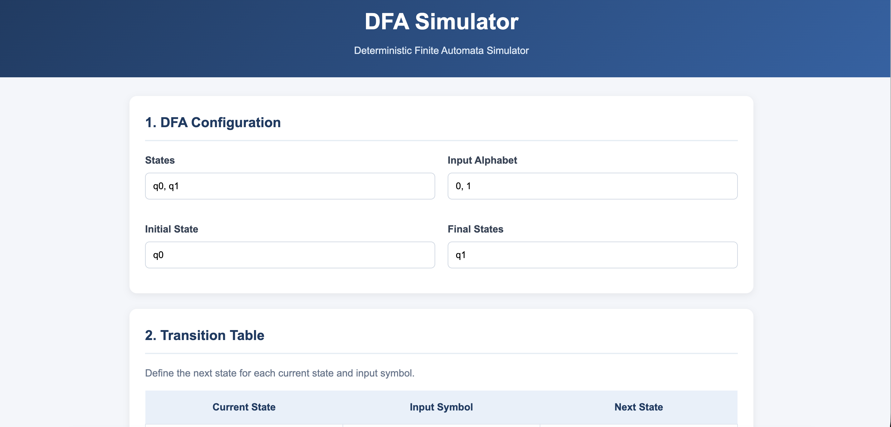

# DFA Simulator

An interactive web-based **Deterministic Finite Automaton (DFA) Simulator** that allows users to create a DFA, enter an input string, and check whether the string is accepted or rejected by the automaton.

## Website Preview



## Features

- Define DFA states and input alphabet.
- Select the initial state and final states.
- Create transitions between states.
- Validate DFA configurations.
- Enter an input string for simulation.
- Check whether an input string is accepted or rejected.
- Display the execution path of the DFA.
- Handle empty input strings.
- Visualize the DFA state diagram.

## Technologies Used

- HTML5
- CSS3
- JavaScript
- SVG (for DFA diagram visualization)

## Project Structure

```text
DFA-Simulator/
│
├── index.html
├── style.css
├── script.js
├── visualization.js
├── README.md
│
└── assets/
    └── website.png
```

## How to Run the Project

1. Clone the repository:

   ```bash
   git clone https://github.com/smriti-25/DFA-Simulator.git
   ```

2. Open the project folder:

   ```bash
   cd DFA-Simulator
   ```

3. Open `index.html` in your browser or run it using the VS Code Live Server extension.

## How to Use

1. Enter the DFA states.
2. Enter the input alphabet.
3. Specify the initial state.
4. Enter the final states.
5. Define the transitions for each state and input symbol.
6. Enter the input string.
7. Click the **Simulate** button.
8. View the result and execution path.

## Example DFA

This example recognizes binary strings that end with `1`.

- States: `{q0, q1}`
- Alphabet: `{0, 1}`
- Initial State: `q0`
- Final State: `{q1}`

| Current State | Input 0 | Input 1 |
|---|---|---|
| q0 | q0 | q1 |
| q1 | q0 | q1 |

**Example Results:**

| Input | Result |
|---|---|
| 101 | Accepted |
| 111 | Accepted |
| 100 | Rejected |
| 000 | Rejected |
| Empty String | Rejected |

## Team Project

This project was developed collaboratively as part of our academic coursework on **Automata Theory and Formal Languages**.

## License

This project is created for educational purposes.


